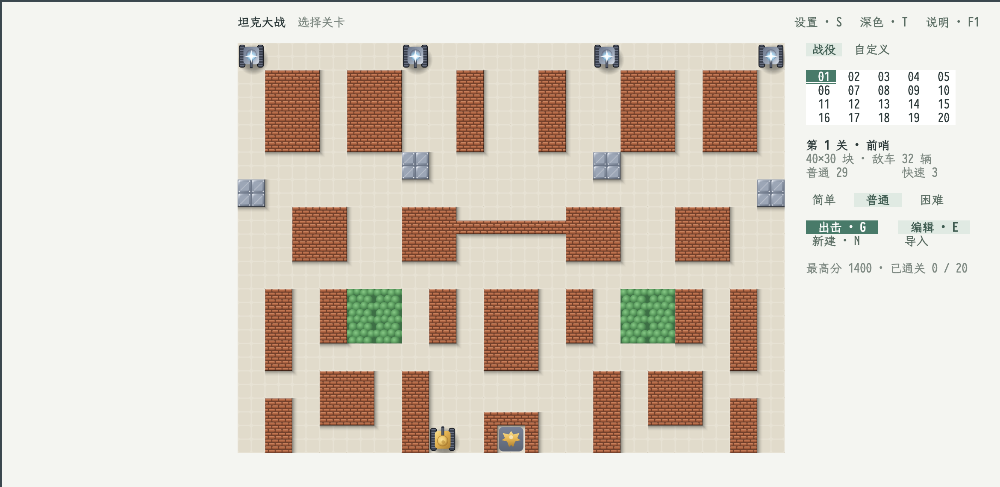
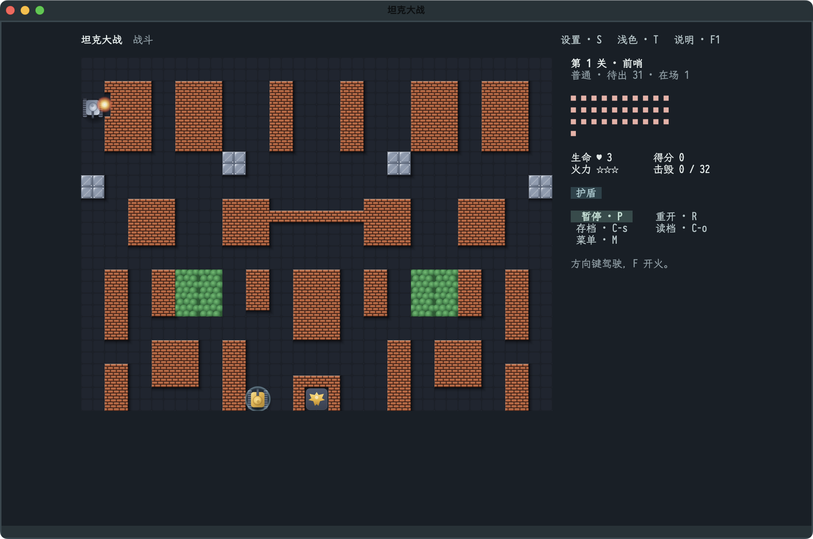

# 坦克大战

A tank battle in Emacs that follows the rules of the 1985 arcade classic:
defend the eagle base at the bottom of the field, destroy every enemy tank of
the stage, and lose when the base falls or your last tank is gone. Twenty
original 40×30 stages raise the difficulty step by step; basic, fast, power and
four-hit armored enemies arrive in waves, and flashing carriers drop helmet,
clock, shovel, star, grenade and extra-tank bonuses.

A headless [Godot](https://godotengine.org) world owns the rules, the fixed
simulation clock and the renderer; this application owns the stage select, the
battle panel, the editor, the settings and the launcher. It is an independent
[GameKit](https://github.com/emacs-taf/etaf-gamekit) application. All
artwork and stages are original.





## Capabilities

- The complete campaign loop: staged enemies with different speed, power and
  armour, bonus carriers, a defendable base, lives, scores and cleared-stage
  progress.
- Godot draws flat vector art with soft lighting in light and dark palettes at
  the screen's own resolution; text displays get an equivalent character grid.
- A map editor that creates, paints and test-plays custom 40×30 stages, and
  stage import from map files.
- Settings that apply immediately: game and tank speed, key sensitivity,
  driving mode, frame rate and, on graphic displays, board size.
- Snapshots through `C-s` and `C-o`; a battle pauses when its buffer stops
  being the selected window's buffer or focus leaves an embedded game.
  Reentering preserves the battle and leaves it paused.

## Prerequisites

| Requirement | Why | Check |
| --- | --- | --- |
| Emacs 29.1 or newer | the ETAF runtime | `emacs --version` |
| `ecss`, `ebox`, `etaf`, `etaf-ui` | the framework and catalog components | every root entry is on `load-path` |
| `etaf-gamekit` and its Godot runtime | simulation host, game instance and state publication | `M-x etaf-gamekit-install-godot` |
| Python 3.9 or newer | GameKit's Godot setup script | `python3 --version` |

## Installation

```sh
git clone https://github.com/emacs-taf/ecss.git
git clone https://github.com/emacs-taf/ebox.git
git clone https://github.com/emacs-taf/etaf.git
git clone https://github.com/emacs-taf/etaf-ui.git
git clone https://github.com/emacs-taf/etaf-gamekit.git
git clone https://github.com/emacs-taf/etaf-tanks.git
make -C etaf-gamekit engine
```

Installed from the ETAF package archive, `M-x etaf-gamekit-install-godot`
installs the same pinned runtime; `make -C etaf-gamekit engine` is the checkout
equivalent.

Add every provider root and this repository to `load-path`:

```elisp
(add-to-list 'load-path "/path/to/ecss")
(add-to-list 'load-path "/path/to/ebox")
(add-to-list 'load-path "/path/to/etaf")
(add-to-list 'load-path "/path/to/etaf-ui")
(add-to-list 'load-path "/path/to/etaf-gamekit")
(add-to-list 'load-path "/path/to/etaf-tanks")
(require 'etaf-tanks)

(global-set-key (kbd "C-c t") #'etaf-tanks-open)
```

`M-x etaf-tanks-open` shows the stage select; choose a stage with the arrow
keys and press `Return` or `G`. Every key also has a button.

## Keys

| Screen | Key | Action |
| --- | --- | --- |
| Menu | Arrows, `Return`, `G` | Choose a stage; start it |
| Menu | `E`, `N`, `D` | Edit the selected map, create a new map, cycle difficulty |
| Battle | Arrow keys | Drive |
| Battle | `Shift`+arrow | Turn in place |
| Battle | `F`, `X` | Fire; stop driving |
| Battle | `P`, `R`, `N`, `M` | Pause or resume, retry, next stage, return |
| Battle | `C-s`, `C-o` | Save or load a snapshot through a file prompt |
| Editor | Arrows, `1`–`9` | Move the cursor; choose a brush |
| Editor | `F`, `D`, `B`, `U` | Paint, toggle continuous painting, brush size, undo |
| Editor | `P`, `C-s`, `M` | Test-play, save the map, return to the menu |
| Any | `S`, `T`, `?` / `F1`, `Q` | Settings, light/dark palette, rules and keys, close |

`?`, `F1` and **说明** open the same searchable help modal inside the game
buffer, without splitting an Emacs window. Its keys follow the current screen;
rules remain available as usage notes. Escape leaves search editing first,
then closes help; clicking outside closes it too and restores the opening focus.

Help, settings and file prompts pause a running battle first, and dismissing
them does not resume it. Retrying or leaving a running battle asks for
confirmation.

## Checks

```sh
make check   # structure, compilation, API and real Godot behavior scenarios
```

`scripts/etaf-tanks-gui-scenarios.el` drives the application in a dedicated
graphical frame; the [manual](docs/manual.md) describes the GUI and
performance acceptance surfaces, including why background results do not
certify foreground input latency.

## Documentation

- [坦克大战 manual](docs/manual.md) — rules, keys, settings, map format,
  editor, snapshots and display.
- [Package entry](etaf-tanks.el) — the supported API inventory.
- [GameKit](https://github.com/emacs-taf/etaf-gamekit) — the shared game
  framework, its adapters and backend installation.

## License

GPL-3.0-or-later; see [LICENSE](LICENSE).
